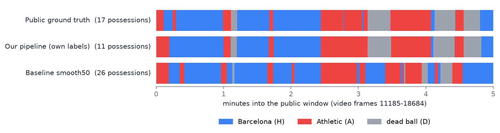
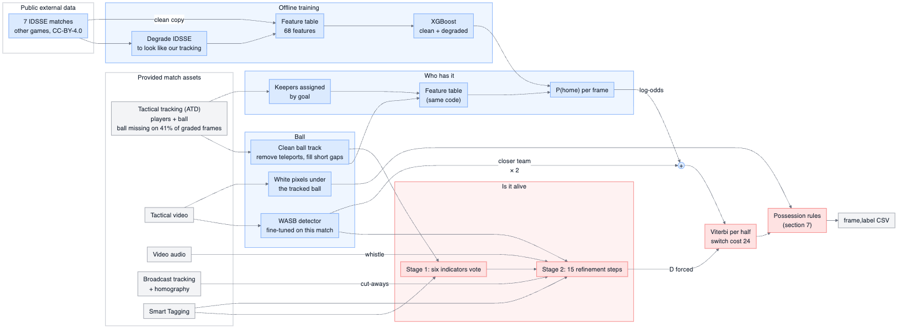

<div align="center">

# ⚽ McDonald's Workers: Who Has the Ball?

**Frame-by-frame ball possession for a full LaLiga match, from tracking data, video and audio**

*More than a Hack 2027 · Phase 1 submission*


-2EA44F)
-2EA44F)

[**Technical document**](submission/McDonald's_Workers.md) · [**Reproduce it**](#reproduce-the-submission) · [**Pipeline code**](pipeline/)

</div>

> [!NOTE]
> **Reading the technical document?** [`submission/McDonald's_Workers.md`](submission/McDonald's_Workers.md)
> is identical to the `McDonald's_Workers.md` we submitted, with its figures and diagrams rendered.
>
> **Need help or have a question?** Email us at
> [chi.tsang.25@ucl.ac.uk](mailto:chi.tsang.25@ucl.ac.uk?subject=McDonald%27s%20Workers%20submission%20%28More%20than%20a%20Hack%202027%29),
> [sui.lim.25@ucl.ac.uk](mailto:sui.lim.25@ucl.ac.uk?subject=McDonald%27s%20Workers%20submission%20%28More%20than%20a%20Hack%202027%29) or [andreea.balmus.25@ucl.ac.uk](mailto:andreea.balmus.25@ucl.ac.uk?subject=McDonald%27s%20Workers%20submission%20%28More%20than%20a%20Hack%202027%29).

---

## Overview

For every one of the ~159,000 graded frames of FC Barcelona vs Athletic Club, the pipeline decides
whether **Barcelona** has the ball (`H`), **Athletic** has it (`A`), or the ball is **dead** (`D`).
The hard part: the provided tracking loses the ball on **41% of frames**, mostly in duels, crowded boxes
and counter-attacks, and the metric rewards getting *whole possessions* right, so a model that flickers
scores badly even when most frames are correct.



*The public five minutes. We get the long possessions and all four stoppages right; the baseline flickers.*

### How it works

| question | approach |
|---|---|
| **Which team has the ball?** | An **XGBoost** model trained on seven public Bundesliga matches ([IDSSE](https://github.com/spoho-datascience/idsse-data)), on clean and deliberately degraded tracking so it copes with a lost ball |
| **Where is the ball when the tracking loses it?** | A published ball detector ([WASB](https://arxiv.org/abs/2311.05237)) adapted to this camera with **algorithm-made labels only** (AdaBN, homography-snapped pseudo-labels, synthetic occlusion). It finds the ball on 27,574 frames the tracking missed |
| **Is the ball alive?** | Rules built from evidence a learned model never sees: the ball over a line, the **referee's whistle** detected from the audio, players stopping, the **broadcast cutting to a replay** |
| **When does a possession start and end?** | A **Viterbi decoder** joins the frame-by-frame probabilities into possessions, charging a cost per switch so one-second blips can't flip possession |



### Highlights

- **Twice the best published baseline's spellF1** on the public window: **0.671** vs 0.326, macroF1 **0.948** vs 0.621.
- **No hand labels on the match.** Every label comes from code, and the pipeline never reads the ground truth.
- **Three extra signals** beyond the provided data: our own video ball detector, whistle detection from audio, and replay detection from the broadcast feed.
- **A custom viewer** (`python -m pipeline.viewer`) that plays the video next to our labels and every signal behind them, which we used to debug each error.
- **Reproducible:** one command rebuilds the submitted file and prints its sha256.

The full write-up (method, validation and where it still goes wrong) is in the
[**technical document**](submission/McDonald's_Workers.md).

---

## Reproduce the submission

Everything runs from the repository root. The trained models are committed in [`weights/`](weights/):
the possession model `xgb_both_all7.json` and the fine-tuned ball detector `ball_video_finetuned.pt`.
One input is not committed: the ball detector's output on the match video (`ball_video.npz`). You
either build it by running the committed detector over the video (~11.6 h, no training involved) or
email us for our copy; see [The video ball](#the-video-ball-ball_videonpz).

> **Organisers: the short version.** With the match data and our `ball_video.npz` you don't build
> or train anything. Put the data in `./data` (or set `MTAH_DATA_DIR`), put `ball_video.npz` at
> **`weights/ball_video.npz`**, and run steps 1, 3 and 5 of [Commands](#commands). The run takes
> about 3 minutes from an empty cache and ends by printing sha256
> `306bb265ff216360b016914342e62e6eccd6c3b44f8404525e8e9012a834ead4`, the file we submitted
> (switch cost 24). We checked this on a fresh copy of the repository: a new `.venv`, no
> `pipeline/cache/`, no earlier results.

### What you need

- **Python 3.12.** Use exactly this version: newer ones such as 3.15 can't install the pinned scipy
  and torch. Check with `python3.12 --version`.
- **macOS or Linux.** On macOS, XGBoost also needs OpenMP: `brew install libomp`.
- **The match data.** This is the organisers' BAR-ATH data bundle (see below). It is not in this
  repository, because its terms don't allow redistribution.
- **Our ball detector's output on the video** (`ball_video.npz`). It is not committed either: build it
  or email us for it, see [The video ball](#the-video-ball-ball_videonpz).

### The match data

"Match data" means the folder of BAR-ATH files the organisers provide for the challenge: the videos,
the tracking, the homographies and the Smart Tagging. Keep the folder layout and file names exactly as
they come. The pipeline reads these seven files:

```
data/
├─ tactical/
│  ├─ BAR-ATH_tactical.mp4                 the tactical video (audio for the whistle, frames for the ball)
│  ├─ BAR-ATH_tactical_atd.xml             tracking metadata (which track is which team)
│  ├─ BAR-ATH_tactical_atd.txt             tracking: players and ball, every frame
│  ├─ BAR-ATH_tactical_homography.csv      pitch-to-video mapping, every frame
│  └─ BAR-ATH_tactical_smart_tagging.xml   set pieces and goals
└─ broadcast/
   ├─ BAR-ATH_broadcast_atd.txt            broadcast tracking (finds cut-aways to replays)
   └─ BAR-ATH_broadcast_homography.csv     broadcast pitch mapping
```

`BAR-ATH_broadcast.mp4` and `BAR-ATH_broadcast_atd.xml` can be there too, but they aren't read. You
can put the folder in either place:

- **inside this repository** as `./data`, or
- **anywhere else**, and point to it: `export MTAH_DATA_DIR="/path/to/data"` (the folder that holds
  `tactical/` and `broadcast/`). Use quotes if the path has spaces.

### Commands

```bash
# 1. Python 3.12 and OpenMP (macOS shown; on Linux use your package manager, or `uv python install 3.12`)
brew install python@3.12 libomp

# 2. Where the match data is (skip this if it's in ./data)
export MTAH_DATA_DIR="/path/to/data"

# 3. A fresh environment. --clear empties any .venv left from another Python version
python3.12 -m venv --clear .venv
.venv/bin/pip install -r pipeline/requirements.txt

# 4. The video ball: put our copy at weights/ball_video.npz (or build it, see below) and check it
cp /path/to/ball_video.npz weights/ball_video.npz
shasum -a 256 weights/ball_video.npz    # fec098b93c719fb5f4b8e95fad013a5c57e925315db37d1df9d2e764ff5e2689

# 5. Produce the CSV. The run checks its setup first, then builds and validates the file
.venv/bin/python -m pipeline.submission --name mcdonalds_workers

# 6. Optional: validate it again on its own
.venv/bin/python evaluation/validate_submission.py evaluation/results/mcdonalds_workers.csv
```

The labels are written to **`evaluation/results/mcdonalds_workers.csv`**. The run ends by printing the
file's sha256, `306bb265ff216360b016914342e62e6eccd6c3b44f8404525e8e9012a834ead4`. That matches the
file we submitted, and it is the same on every run given the same `ball_video.npz`.

| step | time |
|---|---|
| Install packages | minutes |
| Video ball | ~11.6 h to build on an Apple M1, or none with our copy |
| Submission | ~3 min fresh, under 1 min cached |

### The video ball (`ball_video.npz`)

Our ball detector's output on the match video (the ball's position on the 27,574 graded frames the
tracking lost) is **not in this repository**: it is frame-level data derived from the match video, which
the data terms don't allow us to publish. The submission needs it, so either:

- **Build it** with the two commands below (~11.6 h on an Apple M1; resumes if interrupted). This only
  runs the committed fine-tuned detector (`weights/ball_video_finetuned.pt`) over the video; nothing is
  trained.
- **Or email us for our copy:** [chi.tsang.25@ucl.ac.uk](mailto:chi.tsang.25@ucl.ac.uk?subject=Request%20for%20ball_video.npz%20%28McDonald%27s%20Workers%2C%20More%20than%20a%20Hack%202027%29&body=Hi%2C%0A%0AI%27m%20reproducing%20the%20McDonald%27s%20Workers%20submission%20for%20More%20than%20a%20Hack%202027.%20Could%20you%20please%20send%20me%20your%20copy%20of%20ball_video.npz%2C%20the%20ball%20detector%27s%20output%20on%20the%20match%20video%2C%20so%20I%20can%20run%20the%20pipeline%20without%20building%20it%3F%0A%0AThanks%2C%0A), [sui.lim.25@ucl.ac.uk](mailto:sui.lim.25@ucl.ac.uk?subject=Request%20for%20ball_video.npz%20%28McDonald%27s%20Workers%2C%20More%20than%20a%20Hack%202027%29&body=Hi%2C%0A%0AI%27m%20reproducing%20the%20McDonald%27s%20Workers%20submission%20for%20More%20than%20a%20Hack%202027.%20Could%20you%20please%20send%20me%20your%20copy%20of%20ball_video.npz%2C%20the%20ball%20detector%27s%20output%20on%20the%20match%20video%2C%20so%20I%20can%20run%20the%20pipeline%20without%20building%20it%3F%0A%0AThanks%2C%0A) or [andreea.balmus.25@ucl.ac.uk](mailto:andreea.balmus.25@ucl.ac.uk?subject=Request%20for%20ball_video.npz%20%28McDonald%27s%20Workers%2C%20More%20than%20a%20Hack%202027%29&body=Hi%2C%0A%0AI%27m%20reproducing%20the%20McDonald%27s%20Workers%20submission%20for%20More%20than%20a%20Hack%202027.%20Could%20you%20please%20send%20me%20your%20copy%20of%20ball_video.npz%2C%20the%20ball%20detector%27s%20output%20on%20the%20match%20video%2C%20so%20I%20can%20run%20the%20pipeline%20without%20building%20it%3F%0A%0AThanks%2C%0A). Put it at
  `weights/ball_video.npz` (or `pipeline/cache/ball_video/ball_video.npz`). Those are the only two
  places the pipeline looks: `pipeline/cache/ball_video.npz`, for example, is not read.

```bash
python3.12 -m venv --clear .venv-video && .venv-video/bin/pip install -r requirements-video.txt
.venv-video/bin/python -c "from pipeline import ball_video; ball_video.build()"
```

Our copy has sha256 `fec098b93c719fb5f4b8e95fad013a5c57e925315db37d1df9d2e764ff5e2689`
(`shasum -a 256 pipeline/cache/ball_video/ball_video.npz`).

**Getting exactly our result.** The build has no random step, so there is no seed to set: runs on the
same machine and versions should give the same file. Ours was built on an Apple M1 with PyTorch's MPS
backend and the versions pinned in `requirements-video.txt` (torch 2.9.1, torchvision 0.24.1,
opencv-python-headless 5.0.0.93, which also decodes the video). On other hardware (CPU or CUDA)
floating-point differences can tip a borderline detection either way, so the file, and then a few
labels in the submission, can differ. If your sha256 doesn't match ours, email us for our copy.

**Retraining the detector** is not needed (its weights are committed) and is not bit-for-bit
reproducible: training on a GPU or MPS isn't deterministic. Every random step uses **seed 0**, the
default of `ball_video.make_adabn`, `occlusion.build_donor_bank`, `ball_video_data.build` and
`ball_video_train.train` (which also sets `torch.manual_seed(0)` and seeds the data loader), so a retrain
comes close to the committed weights but not exactly. The possession model's XGBoost training samples
nothing at random and gives the same model every time.

### What the terminal shows

1. **Start-up checks.** One line each for the Python version, every package, each of the seven data
   files (with its size), the committed weights and the video ball. If anything is wrong, the run
   stops here and lists what to fix. You can run the checks on their own with
   `.venv/bin/python -m pipeline.startup`.
2. **Seven numbered steps**, each with its timing: tracking, ball track, possession model, video
   ball, dead-ball mask, possessions, then writing and validating the file. Progress bars show the
   slow parts. The first run parses the tracking and reads the video's audio and frames
   (about 3 minutes on an Apple M1). That work is cached in `pipeline/cache/`, so later runs take
   under a minute.

### Troubleshooting

- **`objc[…]: Class AVFFrameReceiver is implemented in both …`** warnings on macOS are harmless:
  OpenCV and PyAV each bundle their own copy of FFmpeg, and the output is unaffected.
- **"needs 3.12"** even though you used `python3.12` means your `.venv` was made by another Python and
  still points at it. Step 3's `--clear` fixes this.
- **"video ball not found"**: see [The video ball](#the-video-ball-ball_videonpz).

---

<div align="center">

*Built for [More than a Hack 2027](https://github.com/metrica-sports/more-than-a-hack-2027) ·
licensed under the terms in [LICENSE](LICENSE)*

</div>
