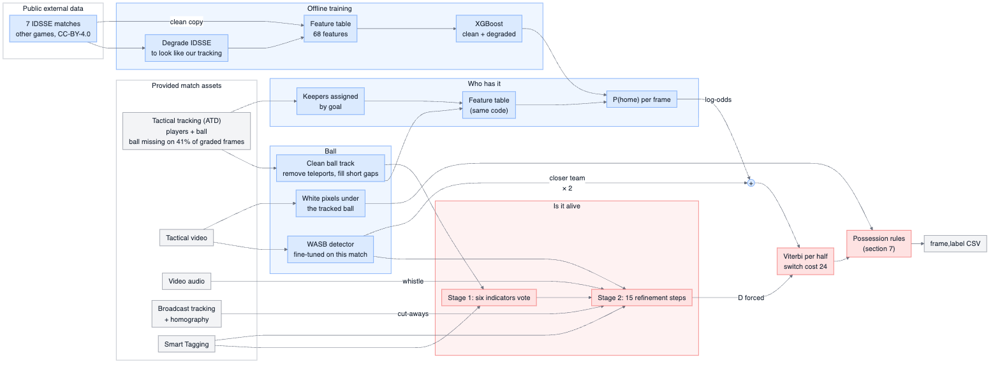

<div align="center">

# 🛠️ The Pipeline

**From raw tracking, video and audio to one possession label per frame**

[**Regenerate**](#regenerate-the-submission) · [**How it works**](#how-it-works) · [**Code map**](#code-map) · [**Notebooks**](#notebooks)

</div>

---

## Regenerate the submission

From the repository root, with Python 3.12 (full instructions, including where the match data goes,
are in the [top-level README](../README.md#reproduce-the-submission)):

```bash
python3.12 -m venv --clear .venv
.venv/bin/pip install -r pipeline/requirements.txt          # macOS: also brew install libomp (XGBoost)
cp /path/to/ball_video.npz weights/ball_video.npz           # the video ball, see below
.venv/bin/python -m pipeline.submission --name mcdonalds_workers
```

| output | |
|---|---|
| file | `evaluation/results/mcdonalds_workers.csv`, validated at the end of the run |
| sha256 | `306bb265ff216360b016914342e62e6eccd6c3b44f8404525e8e9012a834ead4` (the file we submitted) |
| determinism | the same file on every run, given the same `ball_video.npz` |

### 🎥 The video ball

`ball_video.npz` is our ball detector's output on the match video. It is not committed, because it is
frame-level data derived from the match video. There are two ways to get it:

| option | how | time |
|---|---|---|
| **Email us for our copy** | [chi.tsang.25@ucl.ac.uk](mailto:chi.tsang.25@ucl.ac.uk?subject=Request%20for%20ball_video.npz%20%28McDonald%27s%20Workers%2C%20More%20than%20a%20Hack%202027%29&body=Hi%2C%0A%0AI%27m%20reproducing%20the%20McDonald%27s%20Workers%20submission%20for%20More%20than%20a%20Hack%202027.%20Could%20you%20please%20send%20me%20your%20copy%20of%20ball_video.npz%2C%20the%20ball%20detector%27s%20output%20on%20the%20match%20video%2C%20so%20I%20can%20run%20the%20pipeline%20without%20building%20it%3F%0A%0AThanks%2C%0A) or [sui.lim.25@ucl.ac.uk](mailto:sui.lim.25@ucl.ac.uk?subject=Request%20for%20ball_video.npz%20%28McDonald%27s%20Workers%2C%20More%20than%20a%20Hack%202027%29&body=Hi%2C%0A%0AI%27m%20reproducing%20the%20McDonald%27s%20Workers%20submission%20for%20More%20than%20a%20Hack%202027.%20Could%20you%20please%20send%20me%20your%20copy%20of%20ball_video.npz%2C%20the%20ball%20detector%27s%20output%20on%20the%20match%20video%2C%20so%20I%20can%20run%20the%20pipeline%20without%20building%20it%3F%0A%0AThanks%2C%0A), then put it at `weights/ball_video.npz` | none |
| **Build it** | run the committed detector over the video (no training), see below | ~11.6 h on an Apple M1 |

```bash
python3.12 -m venv --clear .venv-video && .venv-video/bin/pip install -r requirements-video.txt
.venv-video/bin/python -c "from pipeline import ball_video; ball_video.build()"
```

The build writes `pipeline/cache/ball_video/ball_video.npz`. That path and `weights/ball_video.npz`
are the only two places the pipeline looks. Our copy has sha256
`fec098b93c719fb5f4b8e95fad013a5c57e925315db37d1df9d2e764ff5e2689`. To get exactly that file, see
[The video ball](../README.md#the-video-ball-ball_videonpz) in the top-level README.

### ⚖️ Trained weights

Both models are committed in [`weights/`](../weights/), so nothing needs training:

| file | what it is |
|---|---|
| `xgb_both_all7.json` | XGBoost possession model, trained on the seven public IDSSE matches only |
| `ball_video_finetuned.pt` | WASB ball detector, fine-tuned on this match's video with algorithm-made labels |

To retrain the possession model from scratch, see [model/README.md](model/README.md):

```bash
python -m pipeline.model.train_six_tune_seventh --tune --refit   # ~5 min, after building the IDSSE tables
python -m pipeline.model.smoothing
```

---

## How it works



[submission.py](submission.py) runs four stages. Every stage is deterministic, and the docstring in
that file gives the evidence for each setting.

| # | stage | what it does |
|---|---|---|
| 1 | **Possession model** | The XGBoost model ([model/](model/README.md)) gives P(Barcelona has the ball) on every graded frame. Goalkeepers count for the team whose goal they stand in ([keepers.py](keepers.py)), since the tracker can put either keeper in either team's slot. |
| 2 | **Video ball** | Where the tracking has lost the ball, our detector's position ([ball_video.py](ball_video.py)) is added to the model's evidence. |
| 3 | **Dead ball** | Task 4's mask ([dead_ball.py](dead_ball.py)), refined by [dead_refine.py](dead_refine.py), see below. |
| 4 | **Viterbi decoder** | [decoder.py](decoder.py) joins the frame probabilities into possessions, charging a cost of 24 per switch so blips can't flip possession. |

After decoding, a possession nobody saw the ball in goes back to the team on either side, and so does
one whose tracked ball has no ball under it in the video ([ball_seen.py](ball_seen.py)).

**Refining the dead ball.** A stoppage is anchored by one of these:

- a Smart Tagging set piece, or
- the TV broadcast cutting away from play to a replay, close-up or crowd shot ([broadcast.py](broadcast.py)), when something else backs it up.

Its edges are then adjusted:

- the ball over a line marks the stoppage
- fouls are timed by the referee's whistle in the video's audio ([whistle.py](whistle.py))
- early starts move to the duel that stopped play
- edges are snapped, starts with the ball still being carried are trimmed, and stoppages under 2 s are dropped
- restarts are also taken from the tracking once it finds the ball again after losing it

> **No hand labels.** Every label in the file comes from the pipeline, the public five minutes
> included. The published ground truth is only used to check the result
> (`python evaluation/run_evaluation.py`), and no human-produced data about this game goes in.

*Tried and not adopted:* reading touches from the broadcast tracking while the ball is crowded. The
code is in the git history, in commit "broadcast_touches: tried and not adopted".

---

## Code map

| area | modules |
|---|---|
| **Entry points** | [submission.py](submission.py) builds the file · [startup.py](startup.py) checks the setup first · [viewer.py](viewer.py) plays the video with our labels |
| **Possession** | [clues.py](clues.py) per-frame evidence · [decoder.py](decoder.py) Viterbi · [keepers.py](keepers.py) goalkeeper tracks · [model/](model/README.md) XGBoost training |
| **Ball track** | [ball_filled.py](ball_filled.py) cleans it and fills gaps · [ball_impute.py](ball_impute.py) infers the ball from player movement · [ball_seen.py](ball_seen.py) checks the ball is really in the picture · [gap_validation.py](gap_validation.py) tests gap strategies |
| **Video ball detector** | [ball_video.py](ball_video.py) detection and AdaBN · [ball_video_labels.py](ball_video_labels.py) algorithm-made labels · [ball_video_data.py](ball_video_data.py) training data · [ball_video_train.py](ball_video_train.py) fine-tune · [occlusion.py](occlusion.py) synthetic occlusion · [ball_video_io.py](ball_video_io.py) frames and tiles · [wasb/](wasb/) network |
| **Dead ball** | [dead_ball.py](dead_ball.py) the mask · [dead_refine.py](dead_refine.py) its refinement · [whistle.py](whistle.py) the referee's whistle · [broadcast.py](broadcast.py) cut-aways from play |
| **Features** | [feature_table/](feature_table/) the model's features, for IDSSE and for our match |
| **Shared** | [common.py](common.py) data loading and caching · [progress.py](progress.py) terminal progress |

---

## Notebooks

| notebook | task |
|---|---|
| [task1_carry_possession.ipynb](task1_carry_possession.ipynb) | don't call a missing ball a dead ball; builds the final labels |
| [task3_fill_ball_gaps.ipynb](task3_fill_ball_gaps.ipynb) | clean the ball track; identify the ball's position during gaps |
| [task4_dead_ball.ipynb](task4_dead_ball.ipynb) | detect dead-ball stretches and restarts |

### How the tasks connect

```
Task 3  ──save_stage("ball_filled")──►  Task 1  ◄──save_stage("dead_ball")──  Task 4
                                          │
                                          ▼
                              build_labels(...) ──► submit() ──► score()
```

| stage | array | meaning |
|---|---|---|
| `ball_filled.npz` | `ball` (N, 2) | ball position in metres |
| | `ball_source` (N,) | 0 = observed, 1 = interpolated, 2 = missing, 3 = glitch |
| | `gap_team` (N,) | HOME / AWAY / NOBODY, the team Task 3 says has the ball inside long gaps |
| | one entry per long gap | `gap_start`, `gap_end` (exclusive), `gap_team_before`, `gap_team_after`, `gap_exit_out` |
| `dead_ball.npz` | `dead` (N,) bool | the frame is dead ball |

Row `i` of every array is video frame `i`.
